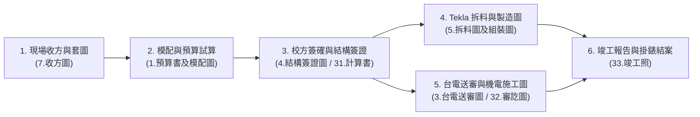

# 太陽能風雨球場標準設計模板（以澎湖嵵裡國小 156.75 kWp 專案為基準）

> [!IMPORTANT]
> **模板定位**：本文件萃取自「澎湖 A-5 嵵裡國小風雨球場（156.75 kWp）」全套竣工與設計資料，將單一籃球場（雙坡跨距 22m × 縱向 31.5m）之**收方、結構簽證、Tekla 拆料製造、浪板/鋁支架、機電送審及預算計價公式**標準化，供設計部門作為後續風雨球場產品線之設計母版。

---

## 一、 專案基準規格速查表（Baseline Specs）

| 類別 | 項目 | 嵵裡國小基準數值 / 規格 | 模板化設計原則 / 備註 |
| :--- | :--- | :--- | :--- |
| **基本參數** | 標的類型 / 容量 | 單座標準籃球場 / **156.75 kWp** | 模組：同昱 `GTEC-550G9B6C`（550Wp × 285 片） |
| **空間幾何** | 柱距配置 (X × Y) | 跨距 **22.0 m**（雙柱無中柱）× 縱向 **31.5 m**（7 跨） | X 向軸距：`5.5m × 4`（軸 1~5，僅 1、5 軸落柱） Y 向軸距：`5.0m + 5.0m + 5.5m + 5.5m + 5.5m + 5.0m`（軸 A~G） |
| **高程設計** | 簷高 / 脊高 / 坡度 | 柱頂 **+7.0m**（淨高 >6.0m）/ 脊高 **+8.5m~+9.0m** / **6°** | 確保籃球拋物線淨空；設備平台設於 **+4.5m**（軸 5 / A~B 間） |
| **基礎型式** | 鋼筋混凝土基礎 | 縱向連續地梁基礎（斷面 **800 × 700 mm**，深 -800mm） | 主筋 `8-#6`、箍筋 `#4@15`；柱底採 `8-M20×170L` 化學錨栓 |
| **結構設計** | 耐風 / 耐震參數 | 基本設計風速 $V_{10}(C) = 33\text{ m/sec}$、地況 B、$I = 1.1$ | 澎湖外島高風壓區，構架應力比控制在 $\text{Ratio} \le 0.95$ |
| **屋面系統** | 浪板 / 鋁支架 | 0.6mm 清板（241.2 坪）+ 40×40 側開鋁擠型支架 | 浪板區採 **h 型腳座**（1,125 只）、中脊採 **L 型腳座**（90 只），**6 點上壓** |
| **機電系統** | 變流器配置 | 新望 `PV-110KH-U` (110kW) × 1 + `PV-30000H-U` (30kW) × 1 | DC/AC 比 = $156.75 / 140 = 1.12$；併接 3Φ4W 220/380V 內線 |

---

## 二、 標準設計作業流程與圖件交付物（SOP & Deliverables）

### 各階段標準資料夾與必備圖檔清單

1. **`7.收方圖`（先期勘查階段）**
   - 必備圖檔：[[案號]-[案名]-收方及柱位圖.dwg](file:///c:/Users/user/Desktop/YRDES/風雨球場設計模板/7.收方圖/%5B案號%5D-%5B案名%5D-收方及柱位圖.dwg)
   - **設計檢核點**：標示既有籃球場邊線、籃球架位置、階梯/出口動線、周邊建物樓高（如 2F 教室）、草地與**地下暗溝**位置（避開柱位開挖）。
2. **`1.預算書及模配圖`（提案與成本階段）**
   - 必備檔案：[[案號]-[案名]-模組配置圖.dwg](file:///c:/Users/user/Desktop/YRDES/風雨球場設計模板/1.預算書及模配圖/%5B案號%5D-%5B案名%5D-模組配置圖.dwg)、[[案號]-[案名]-模組配置圖(範例).pdf](file:///c:/Users/user/Desktop/YRDES/風雨球場設計模板/1.預算書及模配圖/%5B案號%5D-%5B案名%5D-模組配置圖(範例).pdf)、[[案號]-[案名]-工程預算書(參數化母版).xlsx](file:///c:/Users/user/Desktop/YRDES/風雨球場設計模板/1.預算書及模配圖/%5B案號%5D-%5B案名%5D-工程預算書(參數化母版).xlsx)
   - **設計檢核點**：套疊地籍圖（地號 1291、1318）、確認指北針方位、模組排佈（19 排 × 15 列 = 285 片）、中央留設檢修走道與安全爬梯位置。
3. **`4.結構簽證圖` & `6.竣工報告書定稿參考/31.結構計算書`（法規與學校審查階段）**
   - 必備檔案：[[案號]-[案名]-結構簽證圖.dwg](file:///c:/Users/user/Desktop/YRDES/風雨球場設計模板/4.結構簽證圖/%5B案號%5D-%5B案名%5D-結構簽證圖.dwg)、[[案號]-[案名]-學校簽確圖(範例).pdf](file:///c:/Users/user/Desktop/YRDES/風雨球場設計模板/4.結構簽證圖/%5B案號%5D-%5B案名%5D-學校簽確圖(範例).pdf)、[[案號]-[案名]-結構簽證圖(範例).pdf](file:///c:/Users/user/Desktop/YRDES/風雨球場設計模板/4.結構簽證圖/%5B案號%5D-%5B案名%5D-結構簽證圖(範例).pdf)、[31.[案號]-[案名]-結構計算書(範例).pdf](file:///c:/Users/user/Desktop/YRDES/風雨球場設計模板/6.竣工報告書定稿參考/31.%5B案號%5D-%5B案名%5D-結構計算書(範例).pdf)
   - **設計檢核點**：先出「學校簽確圖」（模配、柱位、立面圖）供校方確認跨距與高度；再由結構技師出具 Midas Gen 3D 結構計算書、免請領雜項執照簽證表、結構安全證明書。
4. **`5.拆料圖及組裝圖`（工廠加工與現場吊裝階段）**
   - 必備檔案：
     - 總圖與補強：[[案號]-[案名]-鋼構拆料總圖.dwg](file:///c:/Users/user/Desktop/YRDES/風雨球場設計模板/5.拆料圖及組裝圖/風雨球場/%5B案號%5D-%5B案名%5D-鋼構拆料總圖.dwg)、[[案號]-[案名]-設備平台結構與補強詳圖.dwg](file:///c:/Users/user/Desktop/YRDES/風雨球場設計模板/5.拆料圖及組裝圖/風雨球場/%5B案號%5D-%5B案名%5D-設備平台結構與補強詳圖.dwg)
     - 現場安裝：[[案號]-[案名]-結構安裝圖(範例).pdf](file:///c:/Users/user/Desktop/YRDES/風雨球場設計模板/5.拆料圖及組裝圖/風雨球場/%5B案號%5D-%5B案名%5D-結構安裝圖(範例).pdf)
     - 鋼構拆料：[[案號]-[案名]-一次加工圖(範例).pdf](file:///c:/Users/user/Desktop/YRDES/風雨球場設計模板/5.拆料圖及組裝圖/風雨球場/%5B案號%5D-%5B案名%5D-一次加工圖(範例).pdf)（單件切鑽）、[[案號]-[案名]-二次加工圖(範例).pdf](file:///c:/Users/user/Desktop/YRDES/風雨球場設計模板/5.拆料圖及組裝圖/風雨球場/%5B案號%5D-%5B案名%5D-二次加工圖(範例).pdf)（構件組焊）、[[案號]-[案名]-板加工圖(範例).pdf](file:///c:/Users/user/Desktop/YRDES/風雨球場設計模板/5.拆料圖及組裝圖/風雨球場/%5B案號%5D-%5B案名%5D-板加工圖(範例).pdf)（鐵板零件）、[[案號]-[案名]-風拉桿製造圖(範例).pdf](file:///c:/Users/user/Desktop/YRDES/風雨球場設計模板/5.拆料圖及組裝圖/風雨球場/%5B案號%5D-%5B案名%5D-風拉桿製造圖(範例).pdf)
     - 支架分料：[[案號]-[案名]-鋁支架分料單(屋脊換L腳座範例).pdf](file:///c:/Users/user/Desktop/YRDES/風雨球場設計模板/5.拆料圖及組裝圖/風雨球場/鋁支架/%5B案號%5D-%5B案名%5D-鋁支架分料單(屋脊換L腳座範例).pdf)
5. **`3.台電送審圖及施工圖` & `6.竣工報告書定稿參考/32.審訖圖`（機電併網階段）**
   - 必備檔案：[[案號]-[案名]-台電送審及施工圖.dwg](file:///c:/Users/user/Desktop/YRDES/風雨球場設計模板/3.台電送審圖及施工圖/%5B案號%5D-%5B案名%5D-台電送審及施工圖.dwg)、[32.[案號]-[案名]-台電審訖圖(範例).pdf](file:///c:/Users/user/Desktop/YRDES/風雨球場設計模板/6.竣工報告書定稿參考/32.%5B案號%5D-%5B案名%5D-台電審訖圖(範例).pdf)、[[案號]-[案名]-機電施工圖(範例).pdf](file:///c:/Users/user/Desktop/YRDES/風雨球場設計模板/3.台電送審圖及施工圖/%5B案號%5D-%5B案名%5D-機電施工圖(範例).pdf)、[[案號]-[案名]-串併及線槽填充率檢討表.xlsx](file:///c:/Users/user/Desktop/YRDES/風雨球場設計模板/3.台電送審圖及施工圖/機電/串並/%5B案號%5D-%5B案名%5D-串併及線槽填充率檢討表.xlsx)

---

## 三、 結構與鋼構標準設計模組（Structural & Tekla Module）

### 1. 構件編號與型鋼選用標準（Tekla 命名規範）
本案以案號 `A-5` 為前綴，後續專案請依 `[案號] + [構件代號]` 統一命名：

| 構件代號 | 角色說明 | 斷面規格 | 材質 | 單件長度 / 數量 | 接合與加工細節 |
| :--- | :--- | :--- | :--- | :--- | :--- |
| **`SC1~SC7`** | 主鋼柱 (Column) | `RH300×300×10×15` | SN400B | $L = 7,136.7\text{ mm}$ × **14 支** | 柱底板 `PL20×500×500` (`D1`) + 8 片加勁板 `PL8×100` (`D2`)；柱頂斜板 `PL16×300×501.5` (`D3`)。 其中 `SC5`(5/B)、`SC7`(5/A) 附設設備平台接合孔。 |
| **`SG1~SG6`** | 東西向大梁 (Rafter) | `RH400×200×8×13` | SN400B | 西側 `SG2/4/5`: $12,584.4\text{ mm}$ × 7 支 東側 `SG1/3/6`: $11,387.7\text{ mm}$ × 7 支 | 跨距 22m 於中央脊部對接（端板 `PL19×200~380×682`，`16-M20×80L` + `8-M20×70L`）；梁柱端採斜隅加腋（Haunch `H10`，長 $2,005.7\text{ mm}$，高 $200\text{ mm}$）。 |
| **`E1~E4`** | 南北向主繫梁 | `RH300×150×6.5×9` | SN400B | 5.0m 跨 (`E1/E3`): $4,780\text{ mm}$ × 9 支 5.5m 跨 (`E2/E4`): $5,280\text{ mm}$ × 9 支 | 配置於柱列（軸 1、5，標高 +7000）與屋脊（軸 3，標高 +8500），採 `4-M20×60L` 接合。 |
| **`CP1~CP4`** | 南北向次梁 / 中間縱梁 | `RH250×125×6×9` | SN400B | $4,680 \sim 5,280\text{ mm}$ × **24 支** | 配置於軸 2、4 屋面中段及軸 1、5 下層（標高 +6000 雙層縱梁抗風），採 `3-M20×60L` 接合。 |
| **`F1~F5` / `BR1`** | 設備平台構架 | `RH150×75×5×7` | SN400B | 懸挑 $1.5\text{ m}$ × 跨距 $5.0\text{ m}$ | 設於軸 5（A~B 柱間，標高 +4500），下方設 2 支斜撐 `BR1` ($1,624.9\text{ mm}$)，鋪設 `PL3.2` 花紋鋼板 (`D21/D22`)。 |
| **`PP1~PP4`** | 屋面與平台 C 型鋼 | `C150×50×20×3.2` | K35 | `PP1`(懸挑 2.4m): 58 支 `PP2`(5.0m): 87 支 `PP3`(5.5m): 87 支 `PP4`(平台): 4 支 | 藉由角鋼 `L105×62×4.5` (`CL1` 單向 58 只、`CL2` 雙向 203 只) 與 `2-M12×25L` 固定於大梁上。 |
| **`BK1~BK2`** | 屋面交叉風拉桿 | $\varnothing 16\text{ mm}$ 圓鋼 + $1/2''$ 伸縮器 | A36 | `BK1`: $11,250\text{ mm}$ × 12 組 `BK2`: $11,470\text{ mm}$ × 12 組 | 共 **24 組**，搭配 `BD-1` 風拉桿連接片（厚度 10T × 48 片）。 |

> [!TIP]
> **Tekla 出圖圖層分級規則**：
> - **一次加工圖 (`H1~H26`, `PP1~PP4`)**：僅標示型鋼單件切斷長度、切角與鑽孔位置（供型鋼加工廠 CNC 鑽切）。
> - **板加工圖 (`CL1~2`, `D1~D22`)**：所有連接板、加勁板、基礎底板、花紋板之獨立裁切鑽孔圖。
> - **二次加工圖 (`SC1~7`, `SG1~6`, `E1~4`, `CP1~4`, `F1~5`)**：標示主材與鐵板組焊位置、焊道、重量及工廠/現場螺栓清單（前置碼 `TB` 為工廠植釘、`TE` 為現場植釘）。

### 2. 屋面浪板、鋁支架與維運安全標準
- **浪板分段尺寸**：單側坡面分為兩段搭接，西側 $6.5\text{ m} + 6.8\text{ m}$，東側 $6.5\text{ m} + 5.6\text{ m}$（含兩端懸挑）。
- **鋁支架分料標準**（參見 [分料單](file:///c:/Users/user/Desktop/YRDES/澎湖A-5-蒔裡國小-風雨球場-竣工報告書(已完成.請行銷協助列印)/設計相關/5.拆料圖及組裝圖/風雨球場/鋁支架/20240919_嵵裡國小%20風雨球場%20分料單%20屋脊換L.pdf)）：
  - **A 區（150 片模組）**：支架長度 $11,900\text{ mm} \text{ (6300+5600)} \times 45\text{ 支}$、連結片 45 只、**h 腳座 585 只**、**L 腳座 45 只**（屋脊中脊板處改用 L 腳座）、中壓塊 405 只、側壓塊 90 只。
  - **B 區（135 片模組）**：支架長度 $10,700\text{ mm} \text{ (6300+4400)} \times 45\text{ 支}$、連結片 45 只、**h 腳座 540 只**、**L 腳座 45 只**、中壓塊 360 只、側壓塊 90 只。
  - **防水與扣件**：腳座底部全面鋪設 EPDM 防水橡膠墊片，採用 1-M8 六角鑽尾自攻釘（SGS 實測抗拉力 $835\text{ kgf} > \text{設計需求 } 40.7\text{ kgf}$）。
- **維運安全配置**：
  - **護籠爬梯**：設於西南角（軸 1 / G），含護籠與轉台。
  - **安全母索**：屋面四周設角鐵立柱（高 1m，斜撐 50cm，間距 2.5m），底部以 `M8-25` 螺栓及不鏽鋼自攻釘固定。
  - **維修步道**：沿屋脊中央（軸 3）及南側屋簷鋪設角鐵框 + 菱形擴張網步道。

---

## 四、 機電與台電送審標準設計模組（MEP & Taipower Module）

### 1. 串併配置邏輯（分區 + 遮陰獨立 MPPT）
本案模組共 285 片（同昱 550Wp，$V_{oc}=49.90\text{V}, V_{mp}=41.96\text{V}, I_{sc}=14.00\text{A}, I_{mp}=13.11\text{A}$），依東西坡向及周邊校舍遮陰區分（參見 [時裡國小-串併.xlsx](file:///c:/Users/user/Desktop/YRDES/澎湖A-5-蒔裡國小-風雨球場-竣工報告書(已完成.請行銷協助列印)/設計相關/3.台電送審圖及施工圖/機電/串並/時裡國小%20-串併.xlsx) 與 [施工圖](file:///c:/Users/user/Desktop/YRDES/澎湖A-5-蒔裡國小-風雨球場-竣工報告書(已完成.請行銷協助列印)/設計相關/3.台電送審圖及施工圖/0421時裡國小-地面型球場-籃球場-施工圖.pdf)）：

| 變流器 | 負責區域 | MPPT 編號 | 串列數 × 並列數 | 片數 | 容量 (kWp) | 設計邏輯說明 |
| :--- | :--- | :--- | :--- | :--- | :--- | :--- |
| **INV-1** 新望 `PV-110KH-U` (110kW, 9 MPPT) | 東側坡面 + 部分西側 (共 225 片) | MPPT 1 ~ 3 | 16 串 × 2 並 (×3 組) | 96 片 | 52.80 | 標準無遮陰區，16 串為基準 ($V_{mp}=671\text{V}$) |
| | | MPPT 4 | 16 串 × 1 並 | 16 片 | 8.80 | 單串獨立迴路 |
| | | MPPT 5 ~ 6 | 12 串 × 1 並 / 11 串 × 1 並 | 23 片 | 12.65 | **遮陰區（24 片級距）**：短串獨立 MPPT，避免拉低主串發電 |
| | | MPPT 7 ~ 8 | 18 串 × 2 並 (×2 組) | 72 片 | 39.60 | 高日照長串區 ($V_{oc}=898\text{V} < 1000\text{V}$) |
| | | MPPT 9 | 18 串 × 1 並 | 18 片 | 9.90 | 單串獨立迴路 |
| **INV-2** 新望 `PV-30000H-U` (30kW, 2 MPPT) | 西側坡面 (共 60 片) | MPPT 1 | 18 串 × 2 並 | 36 片 | 19.80 | 西側主發電區 |
| | | MPPT 2 | 12 串 × 2 並 | 24 片 | 13.20 | **西側遮陰區（鄰近 2F 校舍）**：12 串獨立 MPPT |
| **合計** | **全場** | **11 MPPT** | **共 17 迴路** | **285 片** | **156.75** | 搭配 `20A 1000V` 保險絲於 `DC-1`、`DC-2` 箱內 |

### 2. 線槽填充率與管線標準檢討公式（直接套用至施工圖說明欄）
- **DC 幹線鋁線槽 (`#A`：$100\text{ mm} \times 100\text{ mm}$)**：
  - 容納線材：`PV cable 4.0mm²` × 34 條（外徑 $7.5\text{ mm}$，截面積 $45\text{ mm}^2$）+ 接地母線 `PVC 22mm²` × 1 條（外徑 $9.2\text{ mm}$，截面積 $66\text{ mm}^2$）。
  - 填充率檢討：
    $$\frac{45 \times 34 + 66 \times 1}{100 \times 100} = \frac{1596\text{ mm}^2}{10000\text{ mm}^2} = 15.96\% < 20\% \quad (\text{OK})$$
- **AC 分路鋁線槽 (`#B`：$100\text{ mm} \times 100\text{ mm}$)**：
  - 容納線材：INV-1 用 `XLPE 100mm²` × 4 條（面積 $238\text{ mm}^2$）+ `PVC 22mm²` × 1 條（面積 $66\text{ mm}^2$）+ INV-2 用 `XLPE 14mm²` × 4 條（面積 $57\text{ mm}^2$）+ `PVC 5.5mm²` × 1 條（面積 $20\text{ mm}^2$）。
  - 填充率檢討：
    $$\frac{238 \times 4 + 66 \times 1 + 57 \times 4 + 20 \times 1}{100 \times 100} = \frac{1266\text{ mm}^2}{10000\text{ mm}^2} = 12.66\% < 20\% \quad (\text{OK})$$
- **AC 主幹線 (`#C`、`#D`：AC-1 至 KWH-PV 躉售電表箱及受電箱)**：
  - 管線規格：`Ø82mm (3") RSG 金屬管` × 2 管，內穿 `(XLPE 60mm²-1/C × 4, E22) × 2 迴`。
- **電表箱與接地規範**：
  - 採用 **3Φ4W 低壓附 CT 使用式電錶箱**（材質 `SUS304 2.0t` 防水防塵型，高 2150 × 寬 1350 × 深 500 mm），**表箱離地 1.5~1.8m，內門淨寬 $\ge 55\text{ cm}$**（CT 比流器倍率 $\times 80$）。
  - 接地系統：設備接地電阻 $R < 10\,\Omega$（`E22`）；系統接地電阻 $R < 50\,\Omega$（`E30`）。

---

## 五、 工程預算與參數化估算公式（Cost Estimation Model）

由 [1130507嵵裡國小 工程預算書-156.75kw.xlsx](file:///c:/Users/user/Desktop/YRDES/澎湖A-5-蒔裡國小-風雨球場-竣工報告書(已完成.請行銷協助列印)/設計相關/1.預算書及模配圖/1130507嵵裡國小%20工程預算書-156.75kw.xlsx) 萃取之公司內部估算邏輯，設計人員可依新案場尺寸直接帶入：

| 工項分類 | 細項名稱 | 數量計算公式 / 經驗係數 | 參考單價 | 本案小計 / 每 kW 成本 |
| :--- | :--- | :--- | :--- | :--- |
| **壹、鋼構工程** | 1. RH 型鋼材料費 | $\text{圖面理論重 } (29.44\text{ t}) \times \mathbf{1.11\text{ (損耗倍數)}} = 32.68\text{ t}$ | 28,000 元/噸 | **2,655,559 元** (16,941 元/kW) |
| | 2. 接合及連接板 | $\text{RH 型鋼重} \times \mathbf{10\%} = 3.27\text{ t}$ | 33,000 元/噸 | |
| | 3. RH 型鋼加工 + 鍍鋅 | $(\text{RH 型鋼} + \text{連接板}) = 35.95\text{ t}$ | 加工 10,000 / 鍍鋅 10,000 元/噸 | |
| | 4. F10T M16/M20 高張力螺絲 | $\text{RH 總重} \times \mathbf{1.5\%} = 0.539\text{ t}$ | 49,500 元/噸 | |
| | 5. C 型鋼材料 + 鍍鋅 | $5.27\text{ t}$（C 型鋼螺栓：$23\text{ 排} \times 7\text{ 跨} \times 4 = 644\text{ 組}$） | 材料 27,500 / 鍍鋅 14,000 元/噸 | |
| | 6. 鋼構組立吊裝 | $(\text{RH 總重} + \text{C 鋼總重}) = 41.22\text{ t}$ | 7,000 元/噸 (原價6元/kg+10%) | |
| | 7. 柱底配件與防撞墊 | 基礎螺絲 1,280 + 無收縮水泥 1,280 + **鋼柱防護墊 11,000** | 13,560 元/座 × 14 座 | |
| **貳、浪板工程** | 0.6 清板 + 中脊包邊 + 白鐵水槽 | 浪板 $241.2\text{ 坪}$ / 中脊 $263.4\text{ 呎}$ / 30cm 白鐵水槽 $231.75\text{ 呎}$ | 浪板 1,700/坪、水槽 330/呎 | **512,873 元** (3,272 元/kW) |
| **參、鋁擠支架** | 鋁支架材料 + 模組支架安裝 | 支架材料 $2,700\text{ 元/kW}$ + 安裝 $2,400\text{ 元/kW}$ + 小五金 $50\text{ 元/kW}$ | 另加母索 $115.8\text{m}$、步道 $60.8\text{m}$ (@500元/m) | **921,055 元** (5,876 元/kW) |
| **肆、土木工程** | 基礎 + 棄土 + 圍籬 + 地坪復原 | 基礎 $10,600$ + 棄土 $3,340$ + 復原漆面 $2,640\text{ 元/座}$ ($\times 14\text{ 座}$) | 甲種安全圍籬 $115.8\text{m} \times 1,540\text{ 元/m}$ | **410,443 元** (2,618 元/kW) |
| **陸、機電工程** | 低壓盤體 + 配管線 + 安裝工資 | 盤體共 $316,000\text{ 元}$；線材 $3,200$ + 管槽 $1,300$ + 另料 $850$ + 工資 $2,100\text{ 元/kW}$ | 含外島海運與吊運 | **1,515,013 元** (9,665 元/kW) |
| **柒、簽證與假設** | 技師簽證 + 跑照 + 拉拔 + 保險 | 結構簽證 $35,000$ + 電機簽證 $50,000$ + 跑照 $50,000$ + 拉拔 $15,000$ + 埋管 $65,000$ + 雜項 $500/\text{kW}$ + 保險 $78,000$ | 固定規費與假設工程 | **371,375 元** (2,369 元/kW) |
| **總計 (未稅)** | **全案工程總預算（不含模組與變流器主機）** | | **未稅總計：6,386,318 元** | **40,742 元/kW** |

---

## 六、 設計歷程痛點復盤與「防呆檢核表」（Design QA/QC Checklist）

從本專案 `old/` 歷史版本演進中，我們發現實際執行時發生過以下**重大設計變更**。未來設計人員套用本模板時，必須在出圖前完成下列檢核，可減少 80% 改圖重工：

> [!WARNING]
> **歷史變更教訓（從 `old/` 檔案比對發現之重工點）**：
> 1. **跨距與懸挑變更**：2024/07 學校簽確圖原為 `5m+5m+5.5m+5.5m = 21m` 跨距 + 兩側懸挑 `2.395m`；2024/08 結構簽證時改為 **`5.5m × 4 = 22m` 對稱跨距 + 懸挑 `1.0m`**。**教訓**：初期收方時務必先確認排水溝/暗溝與球場退縮距離，一次定案跨距。
> 2. **容量與串併下修**：2023/07 初版預算為 `161.7 kWp`（294 片），後因屋頂檢修走道與安全爬梯空間調整為 `156.75 kWp`（285 片）。
> 3. **基礎型式變更**：預算書初期以「300×300 獨立基礎 × 14 座 + 6-M24」估價，但最終結構簽證圖改為「**800×700 縱向連續基礎地梁 + 8-M20×170L 化學錨栓**」。**教訓**：球場地質或抗拔需求高時，預算應預留連續基礎之混凝土與鋼筋量。
> 4. **設備平台事後補強**：2025/01 出現 `1140123蒔裡國小-風雨球場 設備平台補強.dwg`，且一次/二次加工圖皆改版至 `v.4`。**教訓**：設備平台（置放 110kW+30kW INV 與 AC/DC 盤）載重集中，標準模板應直接內建 `RH150×75` 雙斜撐 `BR1` 構造。
> 5. **屋脊腳座干涉**：2024/09 鋁支架分料單特別標註「**屋脊換 L**」。**教訓**：屋脊中脊板為平板，無法安裝跨浪波峰的 h 型腳座，分料時屋脊第一排必須預設為 **L 型腳座**。
> 6. **電表箱型式變更**：2024/08 原畫「單獨使用式電表箱（寬 750mm）」，2024/11 審訖圖改為「**附 CT 使用式電表箱（含受電箱雙門寬 1350mm）**」，2025/04 施工圖又新增 `#D` 受電箱進線管線。**教訓**：超過 100kW 併內線案場，一開始就應套用「3Φ4W 低壓附 CT 雙門表箱（寬 1350mm）」圖塊。

### 新案出圖前必勾選 Checklist
- [ ] **地下管網確認**：柱位開挖點是否已避開球場周邊既有暗溝、化糞池與給排水管？
- [ ] **淨高與防撞**：球場邊線至鋼柱內側淨距是否足夠？預算是否已列入「鋼柱防護墊（14 座）」？
- [ ] **設備平台預留**：負責掛載變流器與配電箱的鋼柱（如 `SC5`、`SC7`），在 Tekla 一次加工圖是否已預留平台梁與斜撐的螺栓孔（`16-Ø16`）？
- [ ] **屋脊腳座切換**：鋁支架分料單中，位於屋脊中脊板上的腳座是否已由 h 腳座改為 **L 腳座**？
- [ ] **遮陰串列分離**：鄰近校舍大樓（2F/3F）受早晚遮陰的模組，是否已集中劃分至獨立的短串 MPPT（如 11~12 串），不與無遮陰長串（16~18 串）並聯？
- [ ] **CT 電表箱淨寬**：台電送審圖 E51 電表箱是否已標註「**表箱離地 1.5~1.8m**」及「**內門淨寬 $\ge 55\text{ cm}$**」？
